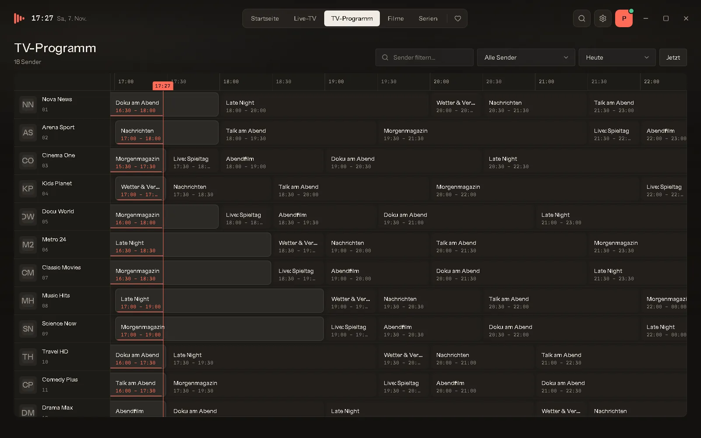
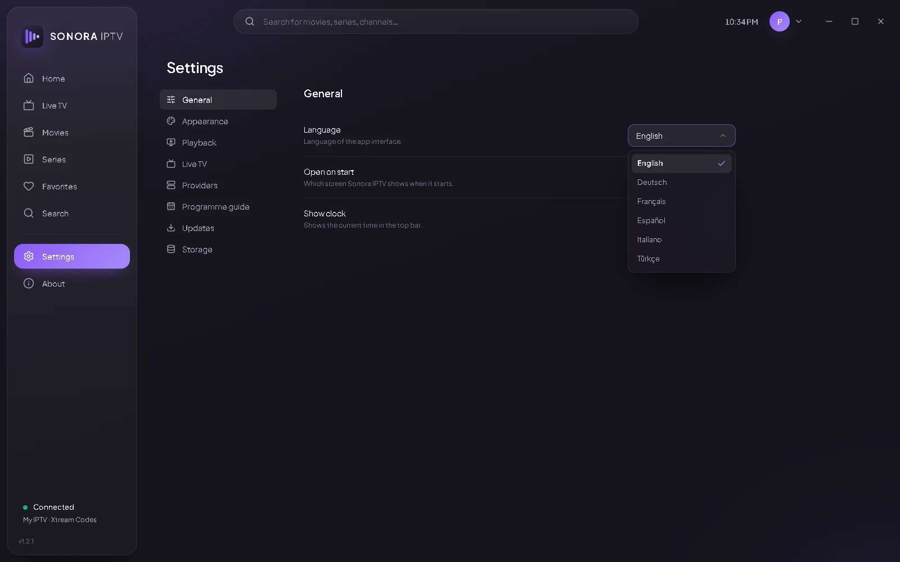

  

<h1 align="center">Sonora IPTV</h1>

  IPTV-Player für Windows 10 und 11. 
  Live-TV mit TV-Programm, Filme und Serien aus deinem eigenen Xtream- oder M3U-Abo.

  
  
  

  <a href="https://github.com/Molulrr/sonora-iptv/releases/latest"><b>Download für Windows</b></a>
  &nbsp;·&nbsp;
  <a href="https://molulrr.github.io/sonora-iptv/"><b>Website</b></a>
  &nbsp;·&nbsp;
  <a href="#anleitung"><b>Anleitung</b></a>

  

## Funktionen

| | |
|---|---|
| **Live-TV** | Alle Sender als Kacheln mit dem, was gerade läuft, daneben die Live-Vorschau. Versionen eines Senders werden zusammengefasst. |
| **TV-Programm** | Programmraster für alle Sender, geladen von deinem Anbieter oder aus einer XMLTV-Datei. |
| **Filme und Serien** | Poster, Handlung, Besetzung, Trailer, Staffeln und Folgen, Top 10 der Woche und neueste Titel. |
| **Weiterschauen** | Filme und Folgen starten dort, wo du aufgehört hast. Die nächste Folge kommt von selbst. |
| **Wiedergabe mit mpv** | Hardware-Decodierung, Tonspuren, Untertitel, Wiedergabegeschwindigkeit und Stream-Infos. |
| **Suche und Favoriten** | Eine Suche für alles, Lieblingskategorien anpinnen, ungenutzte ausblenden. |
| **Tastatur und Fernbedienung** | Pfeiltasten-Steuerung, eigene Tastenkürzel, Oberfläche bis Fernsehgröße. |
| **Sicher und aktuell** | Zugangsdaten in der Windows-Anmeldeinformationsverwaltung, Abo-Laufzeit im Blick, Updates mit einem Klick. |
| **6 Sprachen** | Deutsch, Englisch, Französisch, Spanisch, Italienisch, Türkisch. |

## Ansichten

| Live-TV | TV-Programm |
|---|---|
|  |  |
| **Filme** | **Filmdetails** |
|  |  |
| **Serien** | **Einstellungen** |
|  |  |

## Installation

1. Lade die neueste **`Sonora.IPTV_<Version>_x64-setup.exe`** unter [Releases](https://github.com/Molulrr/sonora-iptv/releases/latest) herunter.
2. Starte die Datei per Doppelklick. Administratorrechte sind nicht nötig.
3. Öffne Sonora IPTV und trage deinen Anbieter ein.

> [!NOTE]
> Zeigt Windows **„Der Computer wurde durch Windows geschützt“**, klicke auf **„Weitere Informationen“** und dann auf **„Trotzdem ausführen“**. Das erscheint, weil die App neu und noch nicht signiert ist.

## Anleitung

### Mit Benutzername und Passwort (Xtream Codes)
1. Beim ersten Start oder unter **Einstellungen → Anbieter** den Typ **Xtream Codes** wählen
2. **Server-URL**, **Benutzername** und **Passwort** eintragen
3. **Verbindung testen**, dann **Speichern**

### Mit einer Playlist (M3U / M3U8)
1. **M3U-/M3U8-Playlist** wählen
2. **Playlist-Link** einfügen oder eine **Datei** auswählen
3. Optional einen **Programmführer (XMLTV)** angeben, dann **Speichern**

### Tastenkürzel im Player

| Taste | Funktion |
|---|---|
| `Leertaste` / `K` | Wiedergabe / Pause |
| `F` | Vollbild |
| `M` | Ton aus / an |
| `↑` / `↓` | Lautstärke |
| `←` / `→` | 10 Sekunden zurück / vor |
| `Bild ↑` / `Bild ↓` | Vorheriger / nächster Sender |
| `[` / `]` | Langsamer / schneller |
| `I` | Stream-Infos |
| `Esc` | Vollbild verlassen |

Alle Kürzel lassen sich unter **Einstellungen → Tastenkürzel** ändern.

### Probleme
- **Stream ruckelt:** Einstellungen → Live-TV, Format auf **HLS** stellen oder den **Netzwerkpuffer** erhöhen
- **Bild bleibt schwarz:** Einstellungen → Wiedergabe, Videoausgabe auf **Separates Fenster** stellen
- **Bildfehler:** **Hardware-Decodierung** ausschalten

Weitere Antworten in den [häufigen Fragen auf der Website](https://molulrr.github.io/sonora-iptv/#faq). Fehler gefunden? [Problem melden](https://github.com/Molulrr/sonora-iptv/issues).

## Voraussetzungen

| | |
|---|---|
| System | Windows 10 / 11, 64-Bit |
| Speicher | ca. 150 MB |
| Internet | ab 10 Mbit/s für HD |
| Du brauchst | ein eigenes IPTV-Abo (Xtream Codes oder M3U) |

---

Sonora IPTV ist ein Medienplayer und stellt keine Inhalte, Sender oder Abos bereit. Nutze ihn nur mit Inhalten, die du abspielen darfst. Wiedergabe mit [mpv](https://mpv.io) (GPL/LGPL). © 2026 Sonora IPTV.
