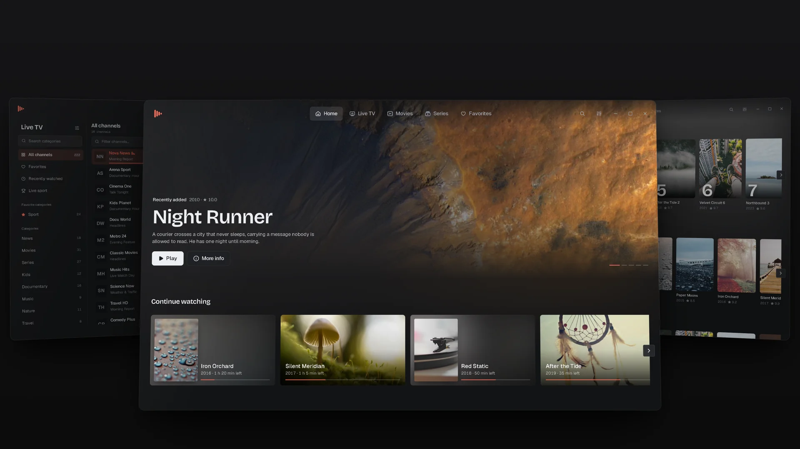
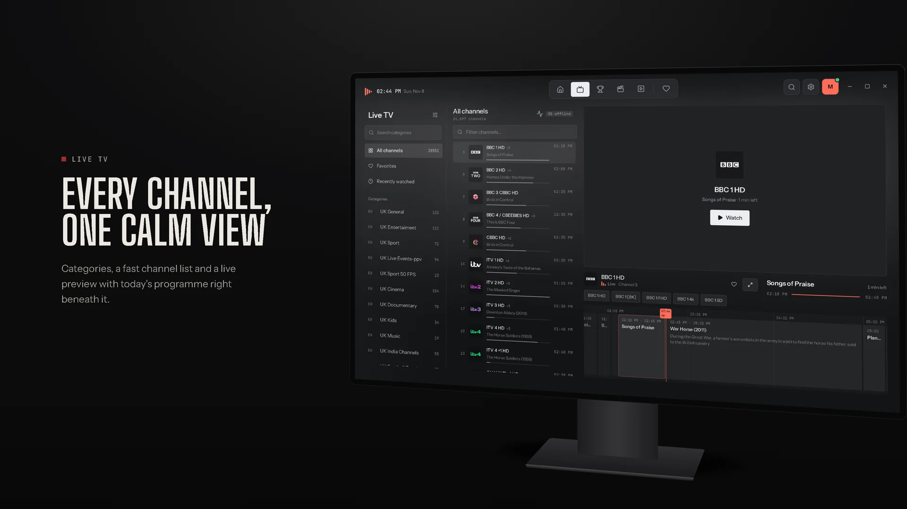
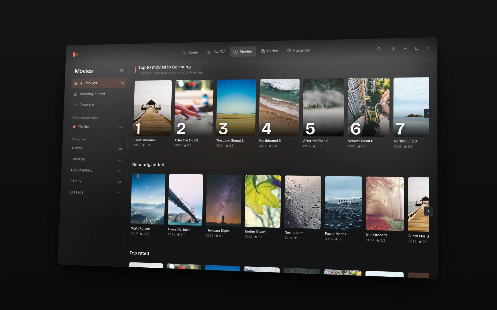
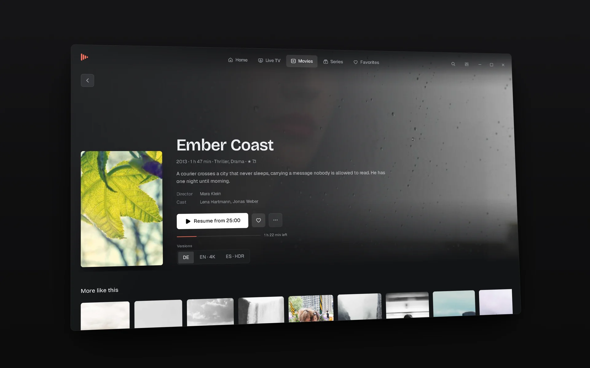
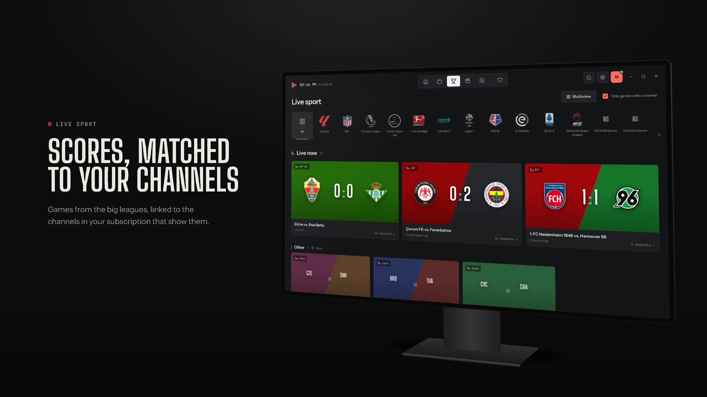
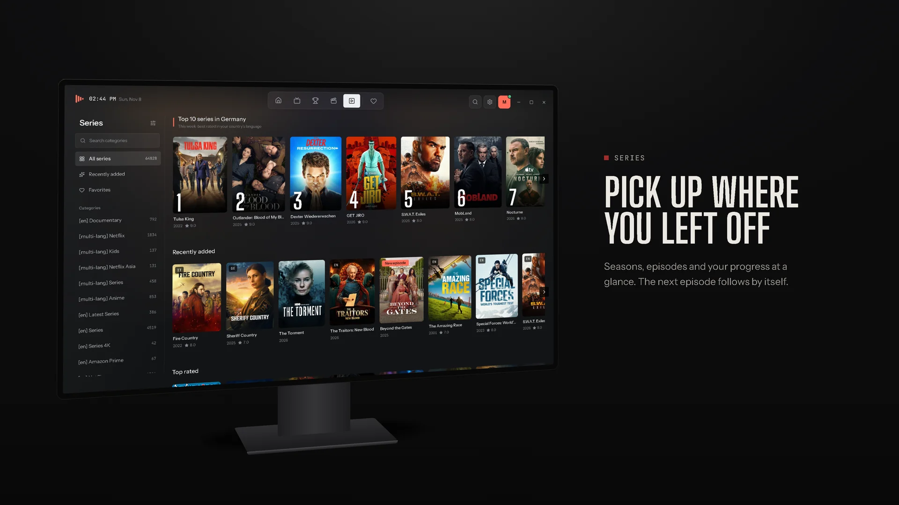
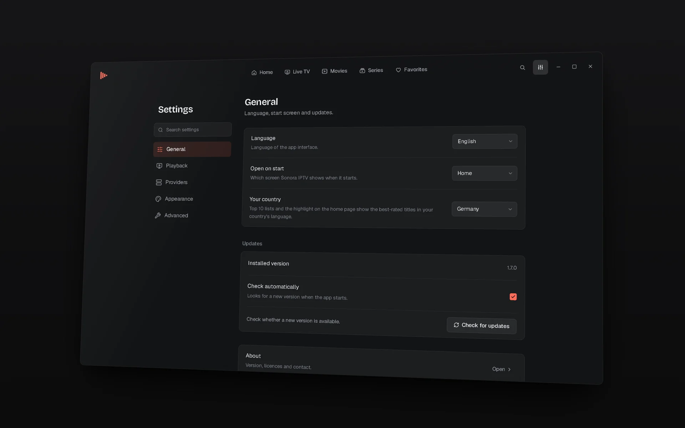

  

<h1 align="center">Sonora IPTV</h1>

  A calm, fast media player for Windows. 
  Live TV, movies and series from the subscription you already have, in one place.

  
  

  <a href="https://github.com/Molulrr/sonora-iptv/releases/latest"><b>Download</b></a>
  &nbsp;·&nbsp;
  <a href="https://molulrr.github.io/sonora-iptv/"><b>Website</b></a>
  &nbsp;·&nbsp;
  <a href="#getting-started"><b>Getting started</b></a>

 

  

 

## About

Sonora IPTV is a player for IPTV subscriptions in the Xtream Codes or M3U format. It brings channels, programme guide, films and series together in one quiet, dark interface that works with a mouse, a keyboard or a remote.

Sonora IPTV is a player only. It does not include any channels, streams, playlists or subscriptions.

## Features

- **Live TV** — categories, channel list, live preview and today's programme as a timeline
- **Movies and series** — posters, details, seasons, episodes and your progress
- **Live sport** — current scores, matched to the channels in your own subscription
- **Continue watching** — resume where you stopped; the next episode starts by itself
- **Playback with mpv** — hardware decoding, audio and subtitle tracks, automatic reconnect
- **Search** — channels, movies and series in one place (<kbd>Ctrl</kbd> + <kbd>F</kbd>)
- **Keyboard and remote** — arrow-key navigation, custom shortcuts, sizes up to TV scale
- **Private** — logins stay in the Windows Credential Manager; updates install in one click

Available in English, German, French, Spanish, Italian and Turkish.

## Screenshots

<table>
  <tr>
    <td width="50%"></td>
    <td width="50%"></td>
  </tr>
  <tr>
    <td align="center">Live TV</td>
    <td align="center">Movies</td>
  </tr>
  <tr>
    <td></td>
    <td></td>
  </tr>
  <tr>
    <td align="center">Details</td>
    <td align="center">Live sport</td>
  </tr>
  <tr>
    <td></td>
    <td></td>
  </tr>
  <tr>
    <td align="center">Series</td>
    <td align="center">Settings</td>
  </tr>
</table>

The screenshots use invented demo data: channel names, titles and teams are fictional, pictures are free stock photos.

## Installation

1. Download **`Sonora.IPTV_<version>_x64-setup.exe`** from [Releases](https://github.com/Molulrr/sonora-iptv/releases/latest).
2. Run the installer. No administrator rights needed.
3. Open Sonora IPTV and add your provider.

Requires Windows 10 or 11 (64-bit) and about 150 MB of disk space.

> [!NOTE]
> If Windows shows **"Windows protected your PC"**, choose **More info** → **Run anyway**. The installer is not code-signed yet.

## Getting started

**Xtream Codes** — choose *Xtream Codes*, enter server URL, username and password, then *Test connection* and *Save*.

**M3U playlist** — choose *M3U / M3U8 playlist*, paste the link or pick a file, optionally add an XMLTV guide, then *Save*.

<b>Player shortcuts</b>

 

| Key | Action |
|---|---|
| <kbd>Space</kbd> | Play / pause |
| <kbd>F</kbd> | Fullscreen |
| <kbd>M</kbd> | Mute |
| <kbd>↑</kbd> <kbd>↓</kbd> | Volume |
| <kbd>←</kbd> <kbd>→</kbd> | Back / forward 10 seconds |
| <kbd>Page Up</kbd> <kbd>Page Down</kbd> | Previous / next channel |
| <kbd>I</kbd> | Stream info |

All shortcuts can be changed under **Settings → Keyboard shortcuts**.

<b>Troubleshooting</b>

 

- **Stream stutters** — Settings → Live TV: set the format to HLS or raise the network buffer.
- **Black picture** — Settings → Playback: set the video output to *Separate window*.
- **Picture errors** — turn off hardware decoding.

## Feedback

Found a bug or have an idea? [Open an issue](https://github.com/Molulrr/sonora-iptv/issues/new) with your Windows version and the Sonora IPTV version (Settings → About). Please never post your provider URL, login or playlist link.

## Legal

Sonora IPTV is free to download and use. It is distributed as a binary; the source code is not published. Playback uses [mpv](https://mpv.io) (GPL/LGPL). Built with [Tauri](https://tauri.app).

Sonora IPTV does not provide, sell or link to any channels, streams or subscriptions. Use it only with content and subscriptions you are legally allowed to use. All names and pictures in the screenshots are fictional or free stock photos.

 

© 2026 Sonora IPTV

