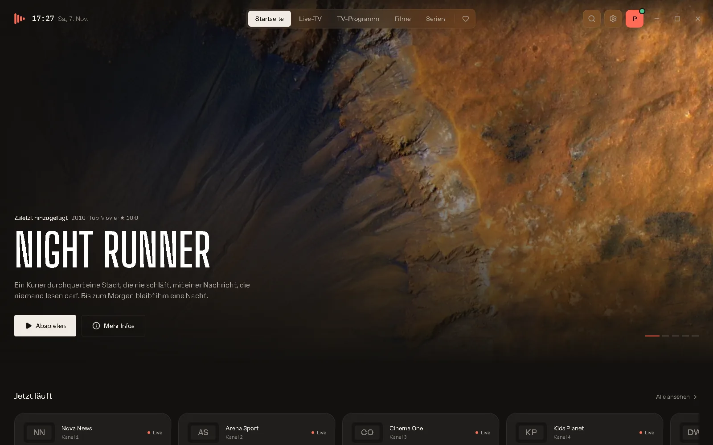
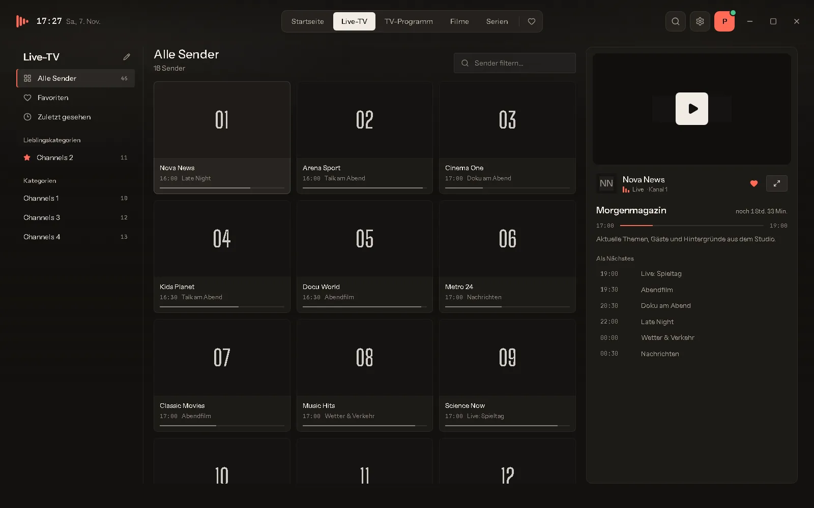
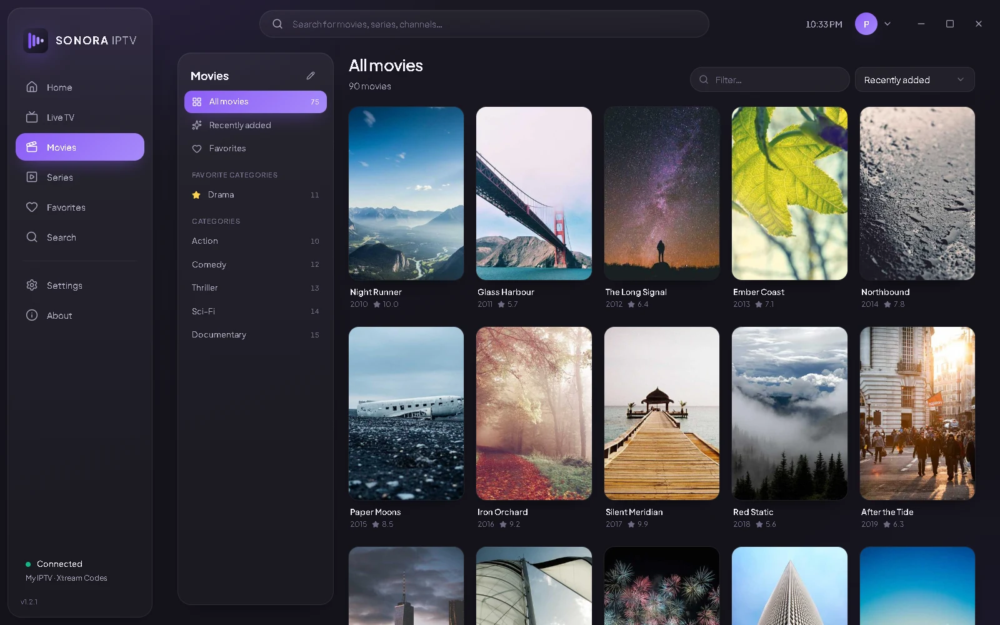
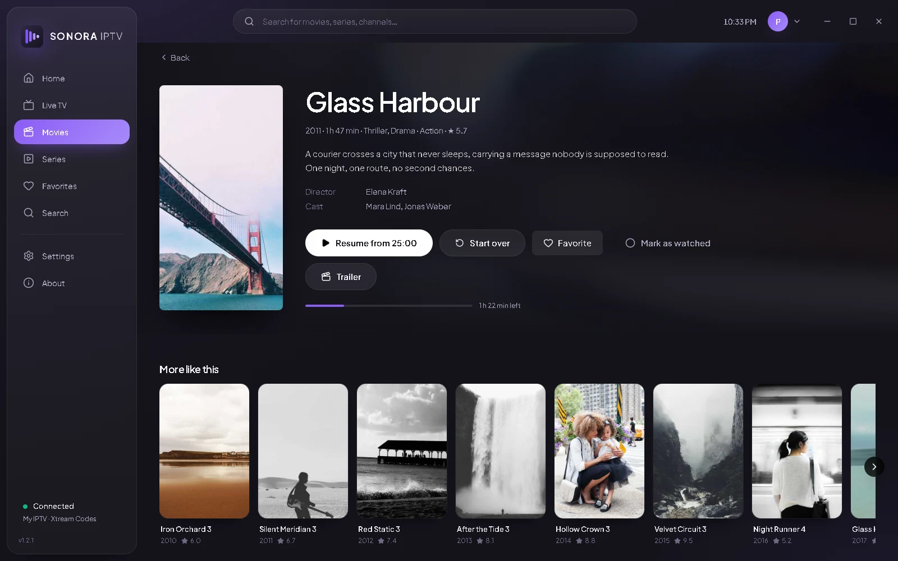
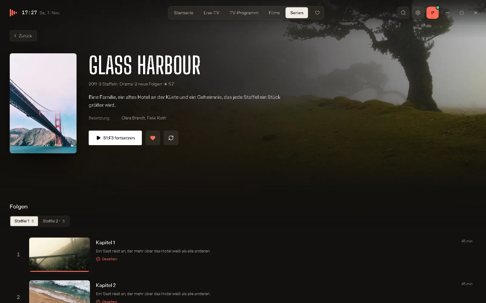

  

<h1 align="center">Sonora IPTV</h1>

  <b>Der elegante IPTV-Player für Windows.</b> 
  Live-TV mit Programmführer, Filme und Serien aus deinem eigenen Xtream- oder M3U-Abo.

  
  
  

  <a href="https://github.com/Molulrr/sonora-iptv/releases/latest"><b>⬇️ Download für Windows</b></a>
  &nbsp;·&nbsp;
  <a href="https://molulrr.github.io/sonora-iptv/"><b>🌐 Webseite</b></a>
  &nbsp;·&nbsp;
  <a href="#anleitung"><b>📖 Anleitung</b></a>

  

---

## ✨ Funktionen

| | |
|---|---|
| 📺 **Live-TV mit Vorschau** | Kategorien, Senderliste und große Live-Vorschau nebeneinander. |
| 🗓️ **Programmführer (EPG)** | Was läuft jetzt, was kommt danach – automatisch geladen. |
| 🎬 **Filme & Serien** | Poster, Beschreibung, Besetzung, Staffeln, Episoden und Trailer. |
| ⏯️ **Weiterschauen** | Filme und Folgen starten dort, wo du aufgehört hast. |
| ▶️ **mpv-Wiedergabe** | Hardware-Decodierung, Deinterlacing, Tonspuren, Untertitel. |
| 🪟 **Mini-Player** | Weiter stöbern, während das Video läuft. |
| 🔎 **Suche & Favoriten** | Eine Suche für alles, eigene Lieblings-Kategorien. |
| 🔒 **Sicher** | Zugangsdaten liegen in der Windows-Anmeldeinformationsverwaltung. |
| 🌍 **6 Sprachen** | Deutsch, Englisch, Französisch, Spanisch, Italienisch, Türkisch. |
| 🔄 **Automatische Updates** | Neue Versionen mit einem Klick installieren. |

## 🖼️ Screenshots

| Live-TV | Filme |
|---|---|
|  |  |
| **Filmdetails** | **Serien** |
|  |  |

## ⬇️ Installation

1. Lade die neueste **`Sonora.IPTV_<Version>_x64-setup.exe`** unter [Releases](https://github.com/Molulrr/sonora-iptv/releases/latest) herunter.
2. Starte die Datei per Doppelklick und folge den Anweisungen (keine Administratorrechte nötig).
3. Öffne Sonora IPTV und füge deinen Anbieter hinzu.

> [!NOTE]
> Zeigt Windows **„Der Computer wurde durch Windows geschützt“**, klicke auf **„Weitere Informationen“** → **„Trotzdem ausführen“**. Das passiert, weil die App noch neu ist.

## 📖 Anleitung

### Anbieter mit Xtream Codes
1. **Einstellungen → Anbieter → „Anbieter hinzufügen“**
2. **Xtream Codes** wählen, Namen vergeben
3. **Server-URL**, **Benutzername** und **Passwort** eintragen
4. **„Verbindung testen“** → **„Speichern“**

### Anbieter mit M3U-/M3U8-Playlist
1. **Einstellungen → Anbieter → „Anbieter hinzufügen“**
2. **M3U-/M3U8-Playlist** wählen
3. **Playlist-URL** einfügen oder eine **Datei** auswählen
4. Optional einen **Programmführer (XMLTV)** angeben → **„Speichern“**

### Tastenkürzel im Player

| Taste | Funktion |
|---|---|
| `Leertaste` / `K` | Wiedergabe / Pause |
| `F` | Vollbild |
| `M` | Ton aus / an |
| `↑` / `↓` | Lautstärke |
| `←` / `→` | 10 Sekunden zurück / vor |
| `Bild ↑` / `Bild ↓` | Vorheriger / nächster Sender |
| `Esc` | Vollbild verlassen / Player verkleinern |

### Probleme?
- **Stream ruckelt:** Einstellungen → Live-TV → *Live-Stream-Format* auf **HLS** stellen oder den **Netzwerkpuffer** erhöhen.
- **Video bleibt schwarz:** Einstellungen → Wiedergabe → *Videoausgabe* auf **Separates Fenster** stellen.
- **Bildfehler:** **Hardware-Decodierung** ausschalten.

Weitere Fragen beantwortet die [FAQ auf der Webseite](https://molulrr.github.io/sonora-iptv/#faq). Fehler gefunden? [Problem melden](https://github.com/Molulrr/sonora-iptv/issues).

## 💻 Systemanforderungen

- Windows 10 oder 11 (64-Bit)
- ca. 150 MB freier Speicher
- Internetverbindung (ab 10 Mbit/s für HD)
- Ein eigenes IPTV-Abo (Xtream Codes oder M3U)

---

Sonora IPTV ist ein Medienplayer und stellt keine Inhalte, Sender oder Abonnements bereit. Nutze ihn ausschließlich mit Inhalten, zu deren Wiedergabe du berechtigt bist. Wiedergabe mit [mpv](https://mpv.io) (GPL/LGPL). © 2026 Sonora IPTV.
