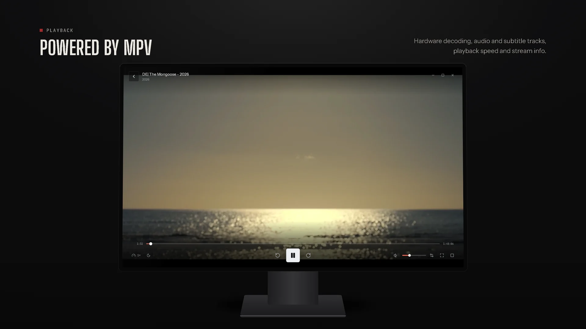
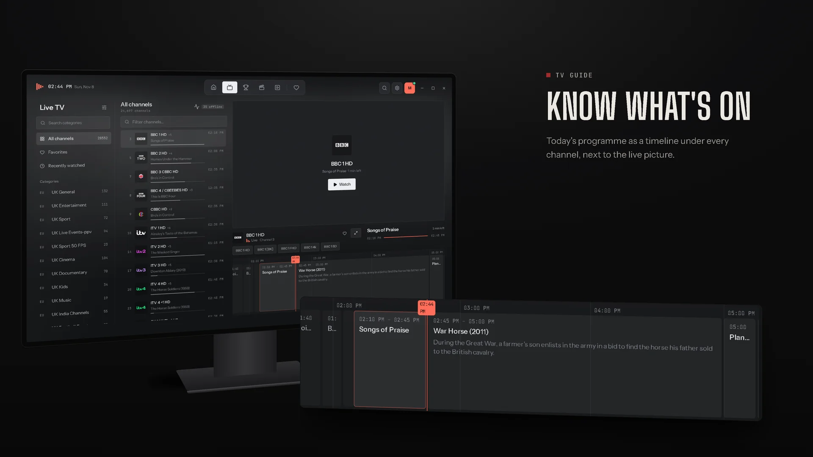

  

<h1 align="center">Sonora IPTV</h1>

  <b>A calm, fast IPTV player for Windows.</b> 
  Live TV, movies and series from your own Xtream Codes or M3U subscription, in one place.

  
  
  
  
  

  <a href="https://github.com/Molulrr/sonora-iptv/releases/latest"><b>Download for Windows</b></a>
  &nbsp;&nbsp;·&nbsp;&nbsp;
  <a href="https://molulrr.github.io/sonora-iptv/"><b>Website</b></a>
  &nbsp;&nbsp;·&nbsp;&nbsp;
  <a href="#getting-started"><b>Getting started</b></a>
  &nbsp;&nbsp;·&nbsp;&nbsp;
  <a href="https://github.com/Molulrr/sonora-iptv/releases"><b>Release notes</b></a>

 

  

 

## Overview

Sonora IPTV turns an IPTV subscription into something that feels like a proper TV app. Channels, programme information, films and series share one quiet interface built for long evenings in front of the screen: dark, legible, and quick to navigate with a mouse, a keyboard or a remote.

Sonora IPTV is a player only. It ships with no channels, streams or subscriptions.

## Features

<table>
  <tr>
    <td width="50%" valign="top">
      <b>Live TV</b> 
      Categories, a fast channel list and a live preview with today's programme as a timeline beneath it. HD, FHD and other versions of a channel are grouped into one.
    </td>
    <td width="50%" valign="top">
      <b>Movies and series</b> 
      Posters, plot, cast and trailers. Top 10 in your country, recently added and best rated. Seasons and episodes with your progress.
    </td>
  </tr>
  <tr>
    <td valign="top">
      <b>Live sport</b> 
      Scores from the major leagues, matched to the channels in your own subscription that show each game.
    </td>
    <td valign="top">
      <b>Continue watching</b> 
      Films and episodes resume where you stopped. The next episode starts by itself. Watch later list and favourites.
    </td>
  </tr>
  <tr>
    <td valign="top">
      <b>Playback with mpv</b> 
      Hardware decoding, audio and subtitle tracks, playback speed and a stream info overlay. Dropped live streams reconnect automatically.
    </td>
    <td valign="top">
      <b>Search everything</b> 
      One search window for channels, movies and series (<kbd>Ctrl</kbd> + <kbd>F</kbd>). Pin favourite categories, hide the ones you never use.
    </td>
  </tr>
  <tr>
    <td valign="top">
      <b>Keyboard and remote</b> 
      Arrow-key navigation, customisable shortcuts and interface sizes up to TV scale for a PC connected to the living-room screen.
    </td>
    <td valign="top">
      <b>Private and up to date</b> 
      Logins are stored in the Windows Credential Manager. Subscription expiry at a glance. Updates install in one click.
    </td>
  </tr>
</table>

Available in English, German, French, Spanish, Italian and Turkish.

## Screenshots

  

<table>
  <tr>
    <td width="50%"></td>
    <td width="50%"></td>
  </tr>
  <tr>
    <td align="center"><b>Movies</b> · Top 10, newest and best rated</td>
    <td align="center"><b>Player</b> · mpv with hardware decoding</td>
  </tr>
  <tr>
    <td></td>
    <td></td>
  </tr>
  <tr>
    <td align="center"><b>TV guide</b> · today's programme per channel</td>
    <td align="center"><b>Live sport</b> · games matched to your channels</td>
  </tr>
  <tr>
    <td></td>
    <td></td>
  </tr>
  <tr>
    <td align="center"><b>Series</b> · seasons, episodes and progress</td>
    <td align="center"><b>Settings</b> · everything in one clear place</td>
  </tr>
</table>

All images show the real application with a real provider. Plain screenshots are in <a href="docs/assets/screenshots"><code>docs/assets/screenshots</code></a>; full-resolution PNG renders are next to the WebP files in <a href="docs/assets"><code>docs/assets</code></a>.

## Installation

| | |
|---|---|
| **System** | Windows 10 or 11, 64-bit |
| **Disk space** | about 150 MB |
| **Connection** | 10 Mbit/s or more for HD |
| **You need** | your own IPTV subscription (Xtream Codes or M3U) |

1. Download the latest **`Sonora.IPTV_<version>_x64-setup.exe`** from [Releases](https://github.com/Molulrr/sonora-iptv/releases/latest).
2. Run the installer. Administrator rights are not required.
3. Open Sonora IPTV and add your provider.

> [!NOTE]
> If Windows shows **"Windows protected your PC"**, choose **More info** and then **Run anyway**. The message appears because the installer is not code-signed yet.

Sonora IPTV checks for updates on start. You can also check under **Settings → Updates**.

## Getting started

**Xtream Codes (username and password)**

1. On first start, or under **Settings → Providers**, choose **Xtream Codes**.
2. Enter the **server URL**, **username** and **password**.
3. Select **Test connection**, then **Save**.

**M3U / M3U8 playlist**

1. Choose **M3U / M3U8 playlist**.
2. Paste the **playlist link** or pick a **file**.
3. Optionally add a **programme guide (XMLTV)**, then **Save**.

<b>Player shortcuts</b>

 

| Key | Action |
|---|---|
| <kbd>Space</kbd> / <kbd>K</kbd> | Play / pause |
| <kbd>F</kbd> | Fullscreen |
| <kbd>M</kbd> | Mute |
| <kbd>↑</kbd> / <kbd>↓</kbd> | Volume |
| <kbd>←</kbd> / <kbd>→</kbd> | Back / forward 10 seconds |
| <kbd>Page Up</kbd> / <kbd>Page Down</kbd> | Previous / next channel |
| <kbd>[</kbd> / <kbd>]</kbd> | Slower / faster |
| <kbd>I</kbd> | Stream info |
| <kbd>Esc</kbd> | Leave fullscreen |

Every shortcut can be changed under **Settings → Keyboard shortcuts**.

<b>Troubleshooting</b>

 

- **Stream stutters:** under **Settings → Live TV**, set the format to **HLS** or raise the **network buffer**.
- **Picture stays black:** under **Settings → Playback**, set the video output to **Separate window**.
- **Picture errors:** turn off **hardware decoding**.

## Technology

| Layer | Stack |
|---|---|
| Desktop shell | [Tauri 2](https://tauri.app) with a Rust backend |
| Interface | React 18, TypeScript, Vite, Tailwind CSS |
| Playback | [mpv](https://mpv.io), embedded and controlled over JSON IPC |
| Data | SQLite (SQLx) for the catalogue, programme guide and history |
| Security | Windows Credential Manager for logins, signed auto-updates |

## Documentation

- [Website](https://molulrr.github.io/sonora-iptv/) — overview, screenshots and setup guide
- [Setup guide](https://molulrr.github.io/sonora-iptv/#guide) — providers, shortcuts and tips
- [FAQ](https://molulrr.github.io/sonora-iptv/#faq) — common questions
- [Release notes](https://github.com/Molulrr/sonora-iptv/releases) — what changed in each version

## Contributing

This repository holds the releases, the website and the documentation. The application source is not published at this time, but feedback shapes every release.

- **Found a bug?** [Open an issue](https://github.com/Molulrr/sonora-iptv/issues/new) with your Windows version, the Sonora IPTV version (Settings → About) and the steps that lead to it.
- **Have an idea?** Open an issue and describe what you would like to do, not only the feature.
- **Translations:** corrections for any of the six languages are welcome as issues.
- **Website and docs:** pull requests for `index.html`, this README and `docs/` are welcome.

Please never post your provider URL, username, password or playlist link in an issue.

## License

Sonora IPTV is free to download and use. The application is distributed as a binary and its source code is not published. Playback uses [mpv](https://mpv.io), licensed under GPL/LGPL.

Sonora IPTV does not provide channels, streams or subscriptions. Use it only with content you are allowed to watch, and only with subscriptions you obtained legally.

 

© 2026 Sonora IPTV

